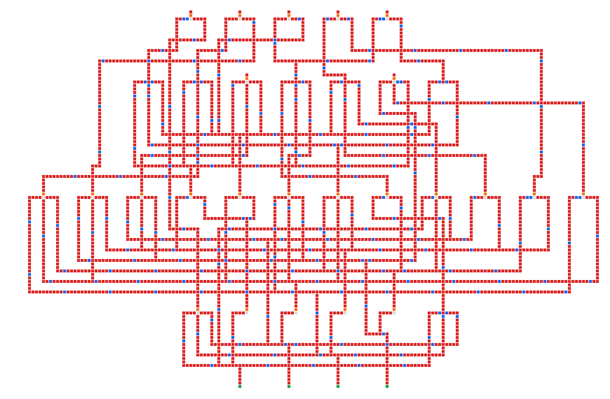

# 電路生成優化：共用軌道間隔（2026-09-30）

本輪基準為 `302c1e7`，前端與 lowered netlist 不變。

## 觀察與根因

從原生七段顯示器的實際 `mc_dump` 產物檢查俯視投影：

紅色是紅石線、藍色是中繼器、橙色是火把、灰色是支撐。此圖忽略高度，只用於觀察占地；交叉不代表電氣連接。

布局列 Z 為 `[110,89,56,23,5]`，四個通道的軌道數為 `[4,8,8,3]`。重建實際 net spans 後，以相同排序試算共用間隔 4、3、2：只有降至 2 才讓第三個通道由 8 條降至 7 條。原始 spans 與試算保存在相鄰 JSON。

根因是 `assign_tracks` 固定要求不同訊號在同一軌道的端點相距至少 4 格。平面共線紅石線的隔離距離為 2（中間一格空白）；已有 `spacing_derivation` 的 simulator 邊界測試。較大間隔拒絕了合法共用，增加通道深度與跨通道直線長度。

## 通解與實驗

共用既有左邊界軌道分配器，以 `COLUMN_CLEARANCE` 作為緊密候選的共用間隔。所有階梯、終端、分支與整體候選仍須通過原本實體驗證。拒絕時依序回到上一輪的間隔 4 緊密布局，再回到歷史布局。`compile_legacy` 的間距 5／共用間隔 4 完全保留。

`LegacyEmission` 記錄實際共用間隔，佈線統計以同一參數重建。原有統計測試增加與上一輪候選的實體成本比較；host／WASM 增加完整生成世界指紋比對。

第一個實驗暫時更改全域間隔以確認收益；正式實作已改為候選參數，歷史布局恢復，沒有修改獨立 baseline 或前端。精確尺寸測試只更新本輪實際產物值。

| 案例 | 方塊：前 → 後 | 包圍盒體積：前 → 後 | 最慢轉換 ticks：前 → 後 |
|---|---:|---:|---:|
| 原生 and4 | 228 → 228 | 3,528 → 3,528 | 28 → 28 |
| Yosys and4 | 214 → 214 | 2,880 → 2,880 | 22 → 22 |
| 原生 seven_segment | 7,408 → 7,270 | 70,416 → 68,460 | 46 → 46 |
| Yosys seven_segment | 8,588 → 8,402 | 164,892 → 159,456 | 76 → 72 |

原生七段方塊再減少 1.9%、體積再減少 2.8%；Yosys 七段方塊減少 2.2%、體積減少 3.3%、最慢延遲減少 5.3%。手寫 segment_a 為 5,712 → 5,664 格，手寫七段為 13,872 → 13,758 格；and4／full_adder 不變。

每個前端案例全部 16×16 輸入轉換通過。三次重測的世界指紋、物理 metrics 與全部時序報告相同；兩個歷史 channel 指紋仍與本輪基準一致。時間量測原樣記錄在 JSON，不參與候選選擇；新增候選若遭拒絕，會多付出一次生成／驗證成本。

## 驗證

使用 `source tools/env.sh`，執行：

- `cargo test --release --lib compile::routing_stats::tests`：7 個通過。
- `channel_safety`：5 個通過；`dff_physical`：1 個通過。
- `frontend_quality_report`：3 次通過，每次四個案例各 256 次轉換。
- `compile_end_to_end`、`frontend_selection`、`mc_dump`、`reference_circuits`、`seven_segment`、`spacing_derivation`：共 36 個通過。
- `cargo check --lib --target wasm32-unknown-unknown`：通過。
- viewer 的 `frontend_compiler`：原生與 Node/WASM 各 2 個通過，包含實際 channel 世界指紋。

此輪 simulator 驗證不代表 Minecraft 客戶端認證。持續流程見 `generator-optimization-loop.md`；本輪提交可由此報告的 git 歷史追溯。
